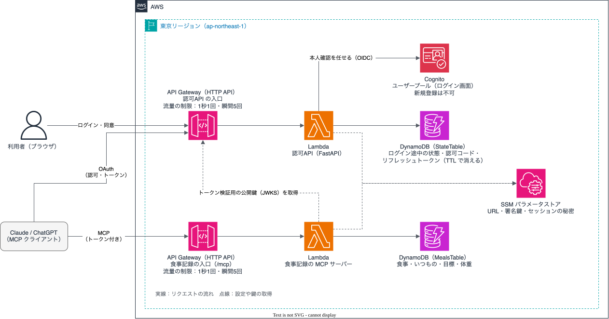

# meal-log-mcp

Claude や ChatGPT に、食事の写真か一言を送るだけで記録できる MCP サーバーです。

## 背景

食生活を見直そうと思い、まずは記録から始めることにしました。
ただ、そのために食事記録のアプリを新しく入れるのは気が進まず、有料のものも多くあります。
安く、いつも使っているアプリで手軽に記録できればよいと考えました。

普段から使っている Claude や ChatGPT なら、写真から料理と量を推定できます。
そこで、推定は AI に任せ、記録と集計だけをこのサーバーが受け持つ形にしました。
目標の計算や週のまとめはサーバーが決まった式で行い、AI に数字を考えさせません。

もう1つの目的は、MCP の認可（OAuth 2.1、CIMD、PKCE、リフレッシュトークン）を自分で実装して理解することです。
そのため、ログイン画面は Cognito に任せ、その前に置く認可API は自作しています。

## 特徴

- **MCP サーバー**：Claude・ChatGPT など、MCP に対応したチャットにコネクタとして登録して使う。専用のアプリや画面はありません
- **利用者ごとの記録**：OAuth でログインした人を識別し、記録はその人の分だけを読み書きします。アクセストークンは食事記録だけに使え、5分で切れます（切れたらリフレッシュトークンで更新します）
- **推論はクライアント側**：写真の解析や栄養の推定は、Claude・ChatGPT の AI が行います。サーバーは AI を呼ばないので、AI の利用料がかかりません。かかるのは Lambda・DynamoDB・API Gateway の従量課金だけで、1人で使う分なら小さく済みます
- **見せ方もクライアント側**：サーバーはデータ（JSON）だけを返し、表・グラフ・入力フォームは Claude・ChatGPT が自分の画面で作ります

## できること

チャットでの頼み方の例と、そのとき起きることです。

| 頼み方 | 起きること |
|---|---|
| 写真を貼って「昼ごはん」 | AI が料理と量を推定して表で見せ、了承を得てから記録する |
| 「朝はいつもの」「昨日の夜と同じ」 | 保存した組み合わせや前の食事を、確認なしで記録する |
| 「今日あと何を食べればいい？」 | 今日の合計と、目標までの残り（kcal・PFC）を返す |
| 「今週をふり返って」 | 日ごとの kcal の推移と、PFC の割合を、表やグラフで見せる |
| 「目標を決めたい」 | 方針（増量・減量・維持）だけでも決められる。体重や身長を答えると、kcal と PFC の目標を計算する |
| 「体重 70kg」「目標まであとどれくらい？」 | 体重を記録し、最近のペースから目標体重までの週数を出す |
| 「さっきのご飯、量を半分に」 | 記録を直す（消すこともできる） |
| 「ログアウトして」 | 連携を解除する（別のアカウントでログインしてしまったとき） |

写真は保存しません。保存するのは、AI が写真から読み取った説明文と栄養の推定値だけです。

## 構成



- 入口は API Gateway の HTTP API だけで、どちらにも流量の制限（1秒1回・瞬間5回）を付けています
- 認可API が Cognito でログインさせ、同意を得てから、食事記録だけに使えるアクセストークンを出します
- ログインからツールの呼び出しまでの流れは [シーケンス図](docs/sequence.md)、設計の考え方は [全体の設計](docs/design.md) と [食事記録の設計](docs/meals-design.md) にあります

図は VS Code の draw.io 拡張で `docs/architecture.drawio.svg` を開いて編集します。

## 使い方

### デプロイする

AWS の認証情報は、環境変数（`AWS_PROFILE` など）で指定しておきます。

```sh
cd cdk && ./build-lambda.sh && npx cdk deploy
../services/authorization/setup-local.sh   # ログインに使うユーザー（test1@example.com）を作る
```

パスワードは `services/authorization/.test1-password` に保存されます（画面には出しません）。

### Claude・ChatGPT につなぐ

`cdk deploy` の出力 `MealsMcpServerUrl`（末尾が `/mcp`）を登録します。

- Claude：「設定 → コネクタ → カスタムコネクタを追加」に URL を入れます。OAuth クライアントは「Claude の公開アイデンティティを使用」のままにします
- ChatGPT：開発者モードでアプリを作成し、URL を入れて認証方式に OAuth を選びます

登録するとログイン画面が開くので、上のユーザーでログインし、同意画面で「許可する」を押します。

### PC で動かす

```sh
(cd services/authorization && uv run uvicorn main:app --port 3000) &
(cd services/meals && uv run python main.py) &   # http://localhost:8001/mcp（記録はメモリーに置く）
```

先に `setup-local.sh` で `services/authorization/.env` を作っておきます。

### テスト

```sh
(cd services/authorization && uv run pytest)
(cd services/meals && uv run pytest)
```

### 片付け

```sh
cd cdk && npx cdk destroy
# 認可APIが初回起動時に作った秘密の値（スタックとは別に残る）
aws ssm delete-parameters --names /cognito-study/authorization/signing-key /cognito-study/authorization/session-secret
```

## 制限

- 本人だけで使う前提です。ログイン画面からの新規登録はできません
- 栄養の値は AI の推定なので、だいたいの目安として使ってください
- `tools/inspector/` の CIMD の文書は localhost にあるので、Lambda の認可API からは取りに行けません（MCP Inspector で試せるのは PC で動かすときだけです）
