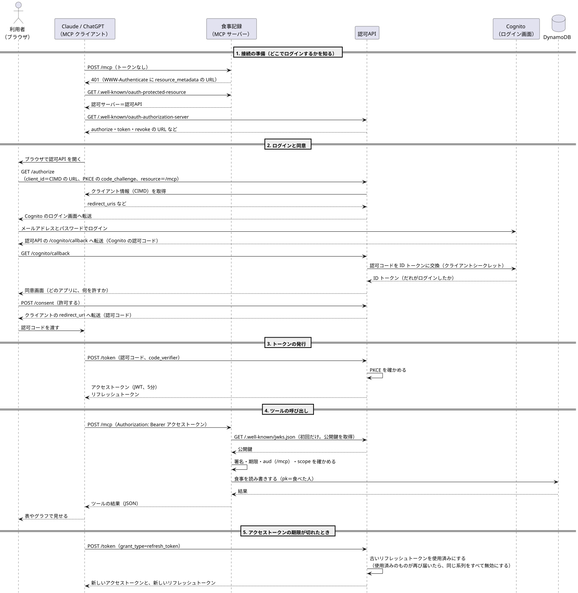

# シーケンス図

Claude や ChatGPT が食事記録につながり、ツールを呼ぶまでの流れです。図の元は `sequence.puml`（PlantUML）で、`plantuml -tsvg docs/sequence.puml` で `sequence.svg` を作り直します。

## 各段階の要点

1. **接続の準備**：クライアントは、食事記録の 401 から「どの認可サーバーでログインするか」を知ります（RFC 9728、RFC 8414）
2. **ログインと同意**：本人確認は Cognito に任せ、どのアプリに何を許すかは認可API が同意画面で決めます。クライアントは事前登録せず、client_id の URL から情報を取ります（CIMD）
3. **トークンの発行**：認可コードを渡したのと同じクライアントかを、PKCE で確かめます
4. **ツールの呼び出し**：食事記録は、認可API の公開鍵でアクセストークンを確かめます。宛先（aud）が食事記録でないトークンは受け付けません（RFC 8707）
5. **期限切れ**：リフレッシュトークンは使うたびに新しくします。使用済みのものが再び届いたら、盗まれたとみなして同じ系列をすべて無効にします
